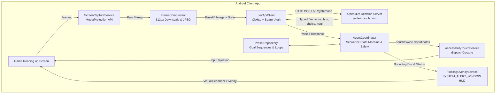

# ⚡ Jev Game Agent for Android

An autonomous, vision-based Android game autopilot powered by **OpenJEV / TypeSafe AI Jev** ("System One" decision engine).

The agent observes live gameplay via screen capture, queries a self-hosted or cloud Jev vision model with typed multi-question prompts (`box`, `choice`, `noul`), and injects precise touches and swipes using Android's Accessibility framework—all without requiring root.

---

## 📑 Table of Contents
1. [System Architecture](#system-architecture)
2. [Directory & Project Structure](#directory--project-structure)
3. [Key Features](#key-features)
4. [Component Deep-Dive](#component-deep-dive)
5. [Decision API & Payload Spec](#decision-api--payload-spec)
6. [Self-Hosted OpenJEV Server (Coolify)](#self-hosted-openjev-server-coolify)
7. [CI/CD & Automated Distribution](#cicd--automated-distribution)
8. [Setup & Permissions Guide](#setup--permissions-guide)
9. [Troubleshooting & Android 14 Notes](#troubleshooting--android-14-notes)

---

## 🏗 System Architecture



### Perception-Decision-Action Flow:
1. **Perception**: `ScreenCaptureService` creates a `VirtualDisplay` via `MediaProjection`. On each frame tick (throttled to ~6.6 FPS / 150ms), frames are captured from `ImageReader`.
2. **Compression**: `FrameCompressor` downscales the bitmap to $\le 512\text{px}$ and encodes it to JPEG ($\approx 30\text{–}60\text{ KB}$) to keep network latency minimal.
3. **Inference**: `JevApiClient` dispatches typed questions to the OpenJEV engine:
   - `game_status`: In-progress, level complete, game over, menu.
   - `action_type`: `tap_target`, `swipe_lane`, `wait`.
   - `target_box`: Precise normalized bounding box `[ymin, xmin, ymax, xmax]`.
   - `swipe_direction`: `up`, `down`, `left`, `right`.
   - `objective_fulfilled`: Boolean (`noul`) verifying if the active goal is completed.
4. **Action Injection**: `AccessibilityTouchService` translates coordinates to device screen resolution and injects synthetic gestures without root.
5. **HUD Feedback**: `FloatingOverlayService` draws bounding boxes and latency metrics over the game while exposing playback and kill controls.

---

## 📂 Directory & Project Structure

```
jev game/
├── .github/
│   └── workflows/
│       └── build-apk.yml          # CI/CD: Automated Gradle build & GitHub Release
├── app/
│   ├── build.gradle.kts           # Dynamic versionCode & versionName from CI run number
│   └── src/main/
│       ├── AndroidManifest.xml    # Permissions: MediaProjection, Overlay, Accessibility, Vibrate
│       └── kotlin/com/jev/gameagent/
│           ├── JevApplication.kt          # Global state, channels & uncaught crash logger
│           ├── MainActivity.kt            # Jetpack Compose Setup UI & Preset Manager
│           ├── core/
│           │   ├── AgentCoordinator.kt    # Sequence orchestrator, loops, timeouts & haptics
│           │   ├── ObjectiveParser.kt     # Goal intent classification
│           │   └── SafetyManager.kt       # Failure rate limiter & emergency stop
│           ├── preset/
│           │   ├── GoalPreset.kt          # Data models: GoalStep, ExecutionPolicy, GoalPreset
│           │   └── PresetRepository.kt    # SharedPreferences JSON store & Import/Export
│           ├── vision/
│           │   ├── ScreenCaptureService.kt # Foreground service, Android 14 callback, Stop HUD action
│           │   └── FrameCompressor.kt     # Fast downscale and base64 compression
│           ├── input/
│           │   ├── AccessibilityTouchService.kt # Gesture injection engine (tap, swipe)
│           │   └── SwipeDirection.kt      # Directional swipe enums
│           ├── overlay/
│           │   └── FloatingOverlayService.kt # Draggable HUD bubble, HUD box canvas, mini-controls
│           └── jev/
│               ├── JevApiClient.kt        # Network client with endpoint auto-migration
│               └── JevModels.kt           # Typed request/response data contracts
├── server/
│   ├── main.py                    # FastAPI server with Bearer auth verification
│   ├── engine.py                  # OpenJEV decision & perception evaluation logic
│   ├── Dockerfile                 # Standalone container for Coolify deployment
│   └── docker-compose.yml         # Container orchestration
├── upload_to_share.js             # Automated Pingvin Share deployment script
└── README.md                      # Project documentation
```

---

## ✨ Key Features

### 1. 🎯 Sequential Goal Presets
- Create ordered lists of goals (e.g., Step 1: *Clear Level* $\rightarrow$ Step 2: *Claim Rewards* $\rightarrow$ Step 3: *Open Shop Chest*).
- **Instant Auto-Advance**: Automatically advances to the next step the exact frame OpenJEV validates `objective_fulfilled >= 0.85`.
- **Pre-loaded Starter Presets**:
  - *Level Progression Loop*
  - *Daily Quest & Chest Routine*
  - *Boss Battle Survival*
- **JSON Import / Export**: One-tap copy all presets to clipboard as JSON, or paste JSON to import custom sequences.

### 2. 🔁 Loop Policies: Repeat $X$ Times or Run for $X$ Minutes
- **Run Once**: Execute the sequence once through.
- **Repeat $X$ Times**: Run the sequence $X$ cycles (e.g. grind 10 levels).
- **Duration Timer**: Keep repeating the sequence for $X$ minutes (e.g. farm for 30 minutes).
- **Cycle Settling Delay**: Configurable 3-second pause between cycles to allow victory screens and level transitions to settle before restarting Step 1.

### 3. 🛑 Multiple Ways to Stop HUD & Autopilot
- **In-Game Floating `✕` Button**: Tapping the red `✕` on the floating bubble closes the HUD and terminates screen perception immediately.
- **Android Notification Action**: A persistent notification in the pull-down notification tray provides a **"🛑 Stop HUD & Perception"** button accessible from anywhere on the device.
- **Main App Stop Card**: The setup screen displays an active service status bar with a **"🛑 Stop HUD"** button.

### 4. 📳 Haptic Feedback & Safety Guards
- **Step Vibration**: Brief haptic pulse when a goal step is accomplished.
- **Victory Pattern**: Triple vibration pulse when an entire sequence or repeat run completes.
- **Step Timeout Guard**: Configurable timeout per step (default: 3 minutes). If a goal gets stuck, the agent automatically pauses and alerts the user on the HUD.
- **Safety Kill-Switch**: Detects consecutive API errors or rapid anomalous taps and suspends execution.

---

## 🔬 Component Deep-Dive

### [`AgentCoordinator.kt`](file:///c:/Users/felix/OneDrive/Dokumente/workspace/Projects/Apps/jev%20game/app/src/main/kotlin/com/jev/gameagent/core/AgentCoordinator.kt)
The central brain connecting vision, inference, and input:
- Manages state machine: `IDLE` $\rightarrow$ `OBSERVING` $\rightarrow$ `DECIDING` $\rightarrow$ `EXECUTING` $\rightarrow$ `PAUSED_TIMEOUT` $\rightarrow$ `OBJECTIVE_COMPLETED` $\rightarrow$ `STOPPED`.
- Tracks `currentCycle`, `currentStepIndex`, `stepStartTimeMs`, and `sessionStartTimeMs`.
- Provides `skipStep()` and `prevStep()` controls for in-game navigation.

### [`FloatingOverlayService.kt`](file:///c:/Users/felix/OneDrive/Dokumente/workspace/Projects/Apps/jev%20game/app/src/main/kotlin/com/jev/gameagent/overlay/FloatingOverlayService.kt)
An Android system overlay (`TYPE_APPLICATION_OVERLAY`):
- **Mini-Bubble**: Draggable floating pill showing the current sequence status (e.g., `[C1/5] 2/3: Claim Rewards`) alongside `⏮`, `⏭`, `PRESET`, `STOP`, and `✕`.
- **HUD Box Canvas**: A full-screen transparent view that renders real-time green bounding boxes over target objects detected by Jev with model confidence and inference latency.

### [`ScreenCaptureService.kt`](file:///c:/Users/felix/OneDrive/Dokumente/workspace/Projects/Apps/jev%20game/app/src/main/kotlin/com/jev/gameagent/vision/ScreenCaptureService.kt)
Android Foreground Service managing screen projection:
- Implements mandatory Android 14 `MediaProjection.Callback` before initializing `VirtualDisplay`.
- Hosts the notification tray with `ACTION_STOP_ALL`.
- Exposes `ScreenCaptureService.stopAll(context)` to cleanly tear down both perception and floating views.

---

## 📡 Decision API & Payload Spec

The client sends a `POST /v1/systemone` request to the Jev backend:

```json
{
  "state": {
    "objective": "Defeat the obstacles/enemies and achieve level victory",
    "screen_width": 1080,
    "screen_height": 2400,
    "image": "<base64_encoded_jpeg>"
  },
  "questions": {
    "game_status": {
      "type": "choice",
      "instructions": "What is the current screen status?",
      "criteria": {
        "in_progress": "active gameplay is running",
        "level_complete": "victory, stage cleared, win, reward popup",
        "game_over": "defeat, you died, fail, retry screen",
        "menu": "main menu, stage selection, pause menu, loading screen"
      }
    },
    "action_type": {
      "type": "choice",
      "instructions": "What immediate action should be performed to advance the objective?",
      "criteria": {
        "tap_target": "tap a specific button, enemy, powerup, or control",
        "swipe_lane": "swipe to dodge, move, jump, or turn",
        "wait": "no action required right now"
      }
    },
    "target_box": {
      "type": "box",
      "instructions": "Precise bounding box of the element to interact with or tap"
    },
    "swipe_direction": {
      "type": "choice",
      "instructions": "If swipe is needed, which direction?",
      "criteria": {
        "up": "swipe up",
        "down": "swipe down",
        "left": "swipe left",
        "right": "swipe right",
        "none": "no swipe"
      }
    },
    "objective_fulfilled": {
      "type": "noul",
      "instructions": "Has the user's objective been successfully completed?"
    }
  }
}
```

The server returns:
```json
{
  "answers": {
    "game_status": { "choice": "in_progress", "confidence": 0.94 },
    "action_type": { "choice": "tap_target", "confidence": 0.91 },
    "target_box": { "box_2d": [0.45, 0.32, 0.55, 0.68], "confidence": 0.88 },
    "objective_fulfilled": { "value": false, "probability": 0.05 }
  }
}
```

---

## ☁️ Self-Hosted OpenJEV Server (Coolify)

The OpenJEV backend is deployed autonomously via Coolify:
- **FQDN**: `https://jev.felixresch.com`
- **Health Check**: `GET https://jev.felixresch.com/health`
- **Dashboard**: `https://jev.felixresch.com/`
- **Authentication**: Strict HTTP Bearer Token (`OPENJEV_API_KEY`). Requests lacking the authorization header receive `401 Unauthorized`; invalid tokens receive `403 Forbidden`.

---

## 🚀 CI/CD & Automated Distribution

- **GitHub Repository**: [felix0123456/jev-game-agent](https://github.com/felix0123456/jev-game-agent)
- **Workflow**: `.github/workflows/build-apk.yml` triggers on every push to `main`:
  - Sets `versionCode = GITHUB_RUN_NUMBER` and `versionName = "1.0.<RUN_NUMBER>"` dynamically.
  - Builds `app-debug.apk` using JDK 17 & Gradle.
  - Creates a GitHub Release tagged `v1.0.0-<RUN_NUMBER>`.
- **Pingvin Share Sync**: `upload_to_share.js` downloads the release binary and uploads it directly to:
  - **Public Share**: [file.felixresch.com/share/jev-game-agent](https://file.felixresch.com/share/jev-game-agent)

---

## 📱 Setup & Permissions Guide

1. **Install APK**: Download and install the latest APK from Pingvin Share.
2. **Grant Overlay Permission**:
   - Tap **Enable** next to *Overlay Permission* in the setup screen $\rightarrow$ Toggle on **Allow display over other apps**.
3. **Enable Accessibility Service**:
   - Tap **Enable** next to *Accessibility Touch Service* $\rightarrow$ Go to *Installed apps / services* $\rightarrow$ Enable **Jev Touch Service**.
4. **Endpoint & Token**:
   - Pre-configured to `https://jev.felixresch.com/v1/systemone` with your active token.
5. **Launch Autopilot**:
   - Pick a preset or tap **🚀 Launch Autopilot HUD** $\rightarrow$ Tap **Start now** on the Android screen recording prompt.
   - Open your favorite game and enjoy!

---

## 🛠 Troubleshooting & Android 14 Notes

- **Android 14 `IllegalStateException: MediaProjection requires a callback`**: Resolved in Build 12+ by registering `MediaProjection.Callback` with the main looper prior to `createVirtualDisplay`.
- **Android 14 `MissingForegroundServiceTypeException`**: Resolved by maintaining `ScreenCaptureService` as the single foreground service (`android:foregroundServiceType="mediaProjection"`) and running `FloatingOverlayService` as a standard background service.
- **In-App Crash Catcher**: Any unhandled exception is caught by `JevApplication.kt` and stored in `crash_log.txt`. The setup screen will display a red alert card with a 1-tap **Copy Log** button.
- **ADB Log Inspection**: Connect your phone via USB with USB Debugging enabled and run:
  ```powershell
  & "C:\Users\felix\Downloads\platform-tools-latest-windows\platform-tools\adb.exe" logcat -d *:E
  ```
